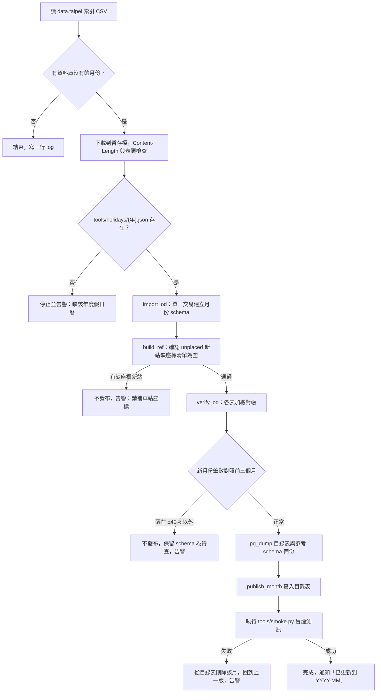

# VPS 自動更新設計

目標：個人或小團隊的單台 VPS，維護成本低，失敗能回滾，不會匯入一半就影響線上資料。

## 現況盤點（決定了設計可以多簡單）

| 項目 | 現況 | 對自動更新的意義 |
| --- | --- | --- |
| 資料存放 | PostgreSQL，每個月一個 schema（`exitpulse_YYYY_MM`），目錄表 `exitpulse_catalog` 只記已發布月份 | 新月份先在自己的 schema 建好，最後才寫入目錄表，這一步就是切換點，天生原子 |
| 匯入交易 | `write_schema` 在單一交易內 DROP、CREATE、COPY，失敗整段回滾 | 不會留下半個月份 |
| 校驗 | `import_od.py` 檢查 CSV 表頭、日期範圍、當月每天都有資料，並寫入 sha256、筆數、總人次。`verify_od.py` 對帳各表加總 | 不用另寫完整性檢查，只要串起來 |
| 資料來源 | data.taipei 索引 CSV（`import_od.py` 的 `INDEX`），逐月 URL | 可以直接讀索引找出「資料庫還沒有的月份」 |
| 重複執行 | `import_od_range.py` 已匯入的月份會略過 | 排程重跑是安全的 |
| API 讀取 | 常駐程序，目錄查詢快取 5 秒，查詢結果快取 120 秒 | 新月份發布後 5 秒內可見，不必重啟 API |

截至 `v1.4.0` 的補齊狀況與後續保留項：
1. **已補齊**：`tools/setup.py` 已改為動態查詢索引取得最新月份與自動建庫、`tools/update_auxiliary.py` 自動檢查當年與隔年假日曆並保留 `--with-metro-map`、圖資更新腳本 `tools/fetch-metro-osm.mjs` 加入 90% 站數下限防護與 `.bak` 備份，並已建立 `deploy/update-all.sh` 搭配 `tools/notify.py` 於更新失敗時發送 Webhook／Telegram 告警。
2. **後續保留項**：待日後補入的僅剩發布前 `pg_dump` 自動輪轉備份，以及新通車車站缺座標（`unplaced`）時的硬性阻斷條件。

## 一、資料自動更新（每月）

流程由一支 `tools/update_monthly.py` 串起，systemd timer 每天 03:30 跑一次。每天跑比每月跑更穩，因為官方發布日不固定，沒有新月份時直接結束。

設計重點：

- **切換點只有一步**：把月份寫進 `exitpulse_catalog`。回滾就是刪掉這一列，月份 schema 可以留著重查。
- **年度假日曆守門**：`build_ref.py` 依賴 `tools/holidays/{年}.json`，若新年度缺少假日檔，`calendar()` 會將元旦、春節等靜默視為一般平日且不報錯。`update_monthly.py` 在匯入該年首個月份前必須先確認檔案存在（資料來源：行政院人事行政總處辦公日曆表 data.gov.tw），缺檔即停止發布並告警。
- **新通車車站座標守門**：`build_ref.py` 遇缺座標站點預設只印出 `no coordinates for:` 而不失敗，未來萬大線、環狀線北段等新線通車時容易靜默少一站。因此必須把 `unplaced` 非空列為阻斷條件，缺座標就不發布並告警。
- **冒煙測試沿用現有工具**：發布後直接執行現有 `tools/smoke.py`，不另外重寫測試腳本。
- **合理性檢查要比 `verify_od` 多一層**：新月份總人次與前三個月同類型日（平日或假日天數校正後）比較，偏離太大就不發布。官方偶爾會補資料或格式變動，這是最可能出事的地方。
- **失敗告警**：最簡單的做法是 systemd `OnFailure=` 呼叫一支 shell，用 Telegram bot 或 `ntfy.sh` 推一則訊息，不必架監控系統。
- **備份**：每次發布前 `pg_dump --schema=exitpulse_catalog --schema=exitpulse_reference`，保留最近 5 份。月份 schema 本身可由官方檔重建，不必備份。
- **前端預設比較**：`od/default.json` 是靜態檔，新月份上線後不會自動變動。建議由同一支腳本在發布成功後重產，或前端改成「最新月份對去年同月」動態決定。
- **歷史月份重算**：官方有時會修正舊月份，可每季加一次 `--recheck`，比對 sha256，不同才重匯。

## 二、程式更新與 1.0.0 生產環境架構

單台 VPS（建議 2 vCPU / 2–4 GB RAM 起步）用最少的零件做到穩健更新：

1. **Docker Compose 與資源配置**
   - `db`（PostgreSQL 18）：透過 Compose 私有網路提供給 API，使用專用資料卷。正式環境透過 `.env` 設定獨立密碼。
   - `api`（uvicorn）：**固定使用 `--workers 1`**。因 [runner.py](../apps/api/runner.py) 內部已用 `ProcessPoolExecutor` 平行處理查詢並維護進程內快取，開多隻 uvicorn worker 反而會讓 DB 連線數與快取記憶體倍增。
   - `web`（Caddy）：提供 Angular 靜態檔，將 `/api` 代理至 API，開放本機 `5080` 埠給主機 Caddy。正式網域和 TLS 憑證由主機 Caddy 管理。
2. **健康檢查與就緒分離**
   - `/health` 僅回傳 `ok`，`/ready` 端點則確認 PostgreSQL 可讀且目錄表有資料。滾動更新或重啟時等 `/ready` 通過再切流量。
3. **靜態檔快取與 Chunk 404 防護**
   - `index.html` 與動態更新的 `od/default.json` 必須設 `Cache-Control: no-cache`（確保使用者每次開頁都能拿到最新入口，不會拿舊 `index.html` 去要已不存在的舊版 `.js`）。
   - 含內容雜湊的 `.js` / `.css` 設 `max-age=31536000, immutable`。
   - `releases/<版本>/` 切換 `current` 符號連結時，**保留最近 3–5 版**不立刻刪除，避免還停在舊分頁的使用者操作時發生延遲載入 404。
4. **發布節奏（建議走 Release Tag）**
   - 推送 `v*` 標籤會觸發 `release.yml`：先跑完整 CI，再建置前端並把壓縮檔與 SHA-256 附到 GitHub Release。CI 通過後用專用部署金鑰在 VPS 執行 `deploy/update-all.sh upgrade`，設定與撤銷方式見 README「持續整合與部署」。首次上線由操作人員完成資料還原、驗證與切換，流程見 [正式部署](../deploy/README.md)。
   - 前端與 API 需要回切時使用同一個發布版本。先等 API `/ready` 通過，再切換 `current`，並從對外 HTTPS 路徑執行 `tools/smoke.py`。
5. **資料庫結構版本（`schema_version`）與備份輪替**
   - `exitpulse_catalog` 建議紀錄 `schema_version`，當程式欄位有變動且尚未完成舊月份 `--recheck` 時能安全識別。
   - 匯入時的暫存 CSV 完畢即刪、`pg_dump` 僅保留最近 5 份、VPS 磁碟使用率超過 `80%` 即發告警，避免長時間運行被日誌與暫存撐爆。
   - 單月匯入在 VPS 上固定帶 `--jobs 1` 執行，避開記憶體尖峰 OOM。`tools/station_info.py --import` 因依賴外部觀光署與資料平台連線，與每月 OD 流程解耦改為獨立週排程，失敗只告警不阻斷新月份上線。

## 三、1.0.0 上線前與自動更新落地順序

1. **上線前必改（阻斷級）**：換掉預設 DB 帳密並確認 `.env` 不進版控、`setup.py` `LATEST_MONTH` 改動態讀取、API 補上 `/ready` 檢查 DB 連線、Caddy 設定 `no-cache` 與 MapLibre 所需的 CSP（放行 `worker-src blob:`）。
2. **資料自動更新鏈**：實作 `tools/update_monthly.py`（讀索引 → 跨年假日曆檢查 → `--jobs 1` 匯入 → `build_ref` `unplaced` 檢查 → `verify_od` → 前三個月筆數 ±40% 檢查 → `pg_dump` → 寫入目錄表 → 重產 `od/default.json` → `tools/smoke.py`）與 `tools/rollback_month.py YYYY-MM`。
3. **排程與告警**：設定 `systemd` daily timer（每日 03:30 檢查）與 `OnFailure` 推播通知（Telegram／ntfy），加上磁碟水位監控。
4. **實機雙重演練**：上線前先在測試環境演練兩次——一次匯入正常新月份並確認 `od/default.json` 更新，一次故意餵缺假日曆、缺座標新站或斷尾 CSV，確認系統會在寫入目錄表前擋下並發出通知。

## 四、所有非 OD 外部資料的穩定自動匯入設計

公開平台的 CSV、JSON、ZIP 都是匯入來源。線上查詢資料以 PostgreSQL 為準。逐時 OD 依日期、時段及起站分組，站區設施按來源驗證後收錄。新北醫院以衛生局名冊配對國土測繪中心的名稱及門牌，依醫事機構代碼去重。臺北市公運處已有轉運站點位時，略過同名的 Wikidata 點位。

除了每月捷運 OD 人次外，ExitPulse 還依賴以下外部資料，全部納入「先下載驗證筆數與結構、通過門檻才交易替換、失敗保留舊版並告警」的原則，絕不讓單一外部平台故障洗白線上資料：

| 資料類別 | 目前對應檔案／腳本 | 穩定官方／外部來源 | 更新頻率 | 防呆與失敗保留機制 |
| --- | --- | --- | --- | --- |
| **年度國定假日／補班曆** | `tools/holidays/{YYYY}.json`（已收錄至 2027） | 政府資料開放平臺（`data.gov.tw`）行政院人事行政總處「中華民國政府行政機關辦公日曆表」 | 每月檢查次年（每年 12 月仍缺檔即告警） | 檢查全年 365／366 天完整且含假日／補班註記後才寫入並重跑 `build_ref`，跨年首月 OD 匯入前強制確認檔案存在 |
| **車站基本資料、出口、無障礙設施** | [station_info.py](../tools/station_info.py)（`BASICS`、`ENTRANCES`、`FACILITIES`、`DORTS`） | 臺北市資料大平臺（`data.taipei`）與捷運局公開資源 | 每週一次（與 OD 更新解耦） | 全部抓回後驗證站數與出口數不得低於現行 DB 的 `85%`，通過才在單一交易內替換，外部 5xx／格式異動時保留舊版並告警 |
| **雙北周邊觀光景點** | [station_info.py](../tools/station_info.py)（`ATTRACTIONS`） | 交通部觀光署 `Attraction-json.zip` | 每週一次（先比對 `ETag`／`Last-Modified`） | 有異動才下載解壓，驗證雙北有效經緯度筆數門檻後寫入，失敗則沿用 DB 既有景點 |
| **雙北 YouBike 2.0 場站** | [station_info.py](../tools/station_info.py)（`YOUBIKE_TP`、`YOUBIKE_NTPC`） | 臺北市交通局、新北市政府資料開放平台公開 JSON（免驗證） | 每週一次（隨 `update_auxiliary.py` 自動更新） | 僅取正常營運場站，計算半徑 `450` 公尺內最近 4 站與車柱數，任一來源暫時逾時印出警告並安全略過，不阻斷主要車站資訊更新 |
| **車站歷史沿革與背景摘要** | [station_info.py](../tools/station_info.py)（`fetch_wiki_story`） | 中文維基百科 REST API（無手寫條目時自動補齊並附原文來源） | 每週隨 `station_info.py --import` 自動補齊 | 僅採明確提到「捷運」或「車站」的條目並限縮前 2 句，單站查不到時安全略過 |
| **周邊通勤主力設施（醫院／大學／商場／鐵路與轉運站）** | [station_info.py](../tools/station_info.py)、[station_hubs_wikidata.py](../tools/station_hubs_wikidata.py)、[station_hospitals_ntpc.py](../tools/station_hospitals_ntpc.py) | Wikidata（CC0）、臺北市醫院清冊、新北市衛生局名冊配對國土測繪中心、臺北市公運處 | 每週一次（隨 `station_info.py --import`） | 補足觀光署未收錄的平日通勤地標，優先讀取 7 天內本地快取並驗證距離（700 公尺內）與名稱正規化 |
| **雙北／桃園行政區月人口與年增減** | [update_auxiliary.py](../tools/update_auxiliary.py)、[station_info.py](../tools/station_info.py) | 內政部戶政司 OpenData API（`ODRP014` 各村里現住人口統計月報） | 每週檢查最新可用民國年月並快取於 `data/district-pop.json` | 若當期 API 暫時無法取得，沿用既有的本地快取而不覆蓋 |
| **車站座標與路網幾何（含新通車路線）** | [fetch-metro-osm.mjs](../tools/fetch-metro-osm.mjs)、[build_ref.py](../tools/build_ref.py) | 主源：`data.taipei` 車站與出口座標 輔源：OpenStreetMap Overpass API（軌道線型與站點） | 每月／偵測到 `unplaced` 新站時觸發 | 新線通車優先由官方站點資料補齊座標，OSM 路網更新先驗站數與線數不減少、備份舊靜態檔後才覆蓋，避免 Overpass 限流破壞地圖 |
| **地點／地標搜尋** | [places.py](../apps/api/places.py) | 預設 `photon.komoot.io`（可透過 `EXITPULSE_PLACES_ENDPOINT` 切換自架實例） | 即時查詢＋30 分鐘記憶體快取 | 上游 `429`／連線失敗時除回傳明確引導外，建議在後端補一層「本地車站名＋出口描述＋觀光署景點」模糊搜尋備援，斷網也能查 |
